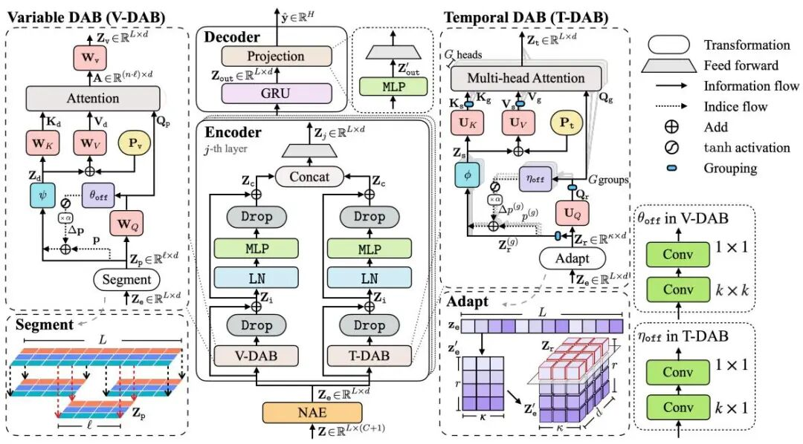
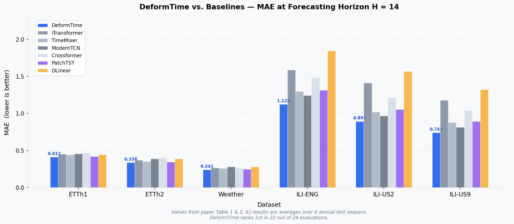
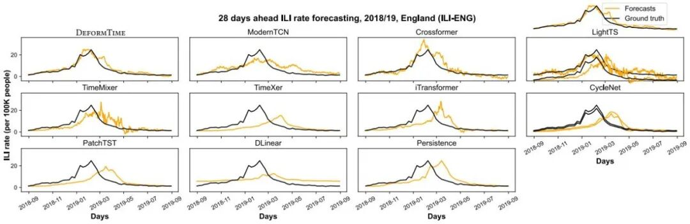
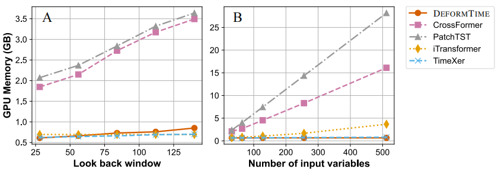
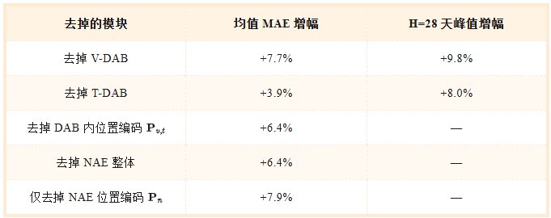
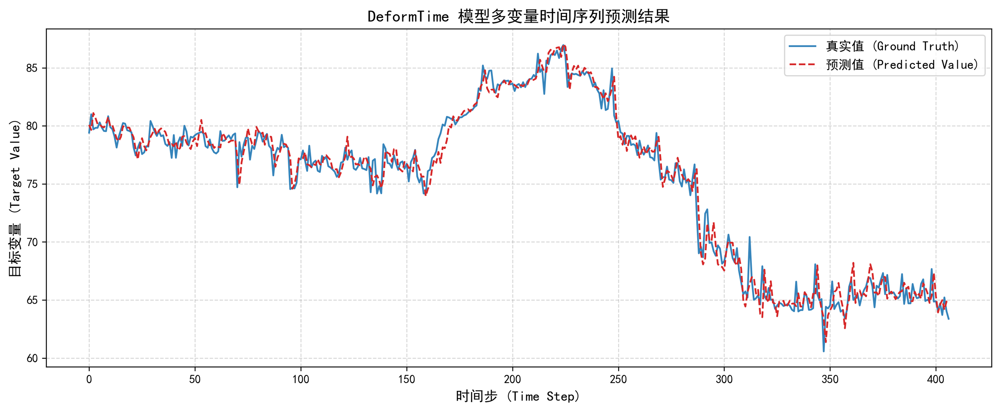
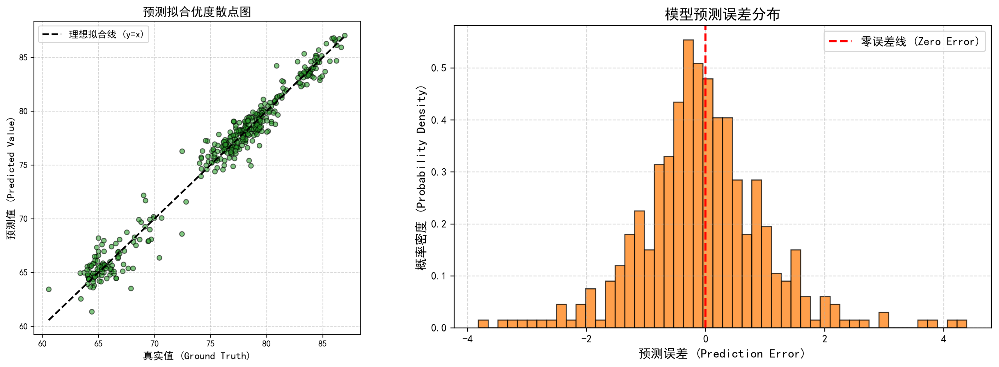
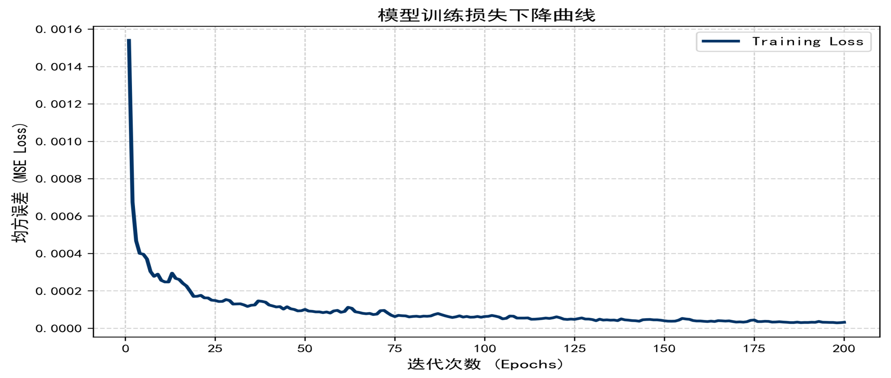

# Unbelievable! Reproducing from a top conference! DeformTime's multivariate regression prediction program, even beginners can publish in a first-tier journal! Full of innovation!

Run on platforms: Python 3.8 and above, PyTorch 1.12 and above
Documentation interpretation
References: DeformTime: Capturing Variable Dependencies with Deformable Attention for Time Series Forecasting, by Yuxuan Shu and Vasilios Lampos (UCL, London), published in the top international conference ICLR 2025.
DeformTime is a deep learning framework specifically designed for multi-variable time series forecasting. Its core innovation is the introduction of deformable attention into the time series prediction field, which addresses the fundamental shortcoming of existing Transformer-based methods that cannot capture cross-variable dynamic temporal offsets. When applied to wind power forecasting, it can adaptively model the dynamic lead effects of meteorological variables such as wind speed, direction, and temperature on wind power, without requiring any prior knowledge of time delays. The prediction accuracy significantly surpasses mainstream methods! The structure is as follows: DeformTime's overall architecture: left side V-DAB captures cross-variable offsets, right side T-DAB captures multi-granularity time series patterns, and the bottom GRU decoder generates predictions.
Original results:
When predicting intervals H=14, DeformTime (blue bars) consistently underperforms the comparison models across all 6 datasets, with the largest gap observed in the influenza dataset.
2018/19 England flu season 28-day early prediction comparison: DeformTime (left upper) orange line closely matches the black line, while iTransformer/TimeXer degenerates into straight lines.
Backward Window Increases from 28 to 140 Steps: DeformTime VRAM never exceeds 1GB, and PatchTST/Crossformer linearly grows. The number of input variables increases from 32 to 512: DeformTime is below 1GB, while PatchTST exceeds 24GB.
Ablative Experiment (ILI dataset):
\n        \n      Description: Mean column represents the average across ILI-ENG and ILI-US9 datasets, with a full prediction interval; H=28 days peak column is calculated separately for the longest interval.
Innovative Disassembly:
① Introducing variable-deformable attention in the temporal domain (core innovation)
Drawing inspiration from the Deformable DETR in visual object detection, replacing fixed alignment attention with adaptive offset sampling. For each time patch, dynamically predict two-dimensional position offsets, allowing the model to "shift perspectives" freely across variable and temporal resolution dimensions, capturing variable dependencies over arbitrary time intervals.
② Variable-deformable attention block V-DAB
Specially modeling the temporal offset relationship across variables. The input sequence is divided into time patches, through 2D convolutional networks predicting offsets, then sampling key embeddings at the offset positions using bilinear interpolation, ultimately achieving cross-temporal step variable cross attention. The offsets are entirely learned by the data, without requiring manual setting.
③ Time-deformable attention block T-DAB
Parallel to V-DAB, focusing on capturing the internal patterns of the same variable under multiple temporal resolutions. Rearrange the length of the sequence into a matrix, with row direction corresponding to short-term rhythms and column direction corresponding to long-term cycles, obtaining two temporal resolution perspectives simultaneously during single attention computation. Using one-dimensional deformable offsets, with shared offsets within groups, parameters are efficient.
④ Neighborhood-aware embedding NAE
Upon discovering that placing variables with similar correlations in adjacent feature channels can enhance local attention efficiency, we have implemented a group embedding based on target correlation coefficients, followed by stacking sinusoidal position encoding before entering the encoder:
- Dual Positional Encoding Coordinated Design
After V-DAB offset sampling, relative positional biases are added, maintaining temporal structure as part of NAE. Ablation experiments reveal counterintuitive conclusions: removing it alone leads to an MAE increase of 7.9%, higher than removing the entire NAE (+6.4%), indicating that positional encoding is core dependent rather than auxiliary component.
- Double-Layer GRU Decoder
The output from the encoder is passed through a double-layer GRU decoder to generate multi-step prediction sequences, naturally adapting to time series autoregression modeling and complementing the Transformer encoder.
- Random Deep Regularization
During training, random skipping of some encoding layers improves the model's robustness to incomplete features, effectively mitigating overfitting, making it more suitable for deep Transformer architectures than Dropout.
- Efficient Memory Utilization Design
Patch operations significantly reduce the complexity of attention, with T-DAB group internal shared offsets further reducing parameter count. Experimental results show that when input variables increase from 32 to 512, DeformTime consistently remains below 1GB memory, while PatchTST soars to over 24GB!
- Exogenous Variables Latent Modeling
The original data (flu data) has a reporting delay of 7 to 14 days due to cases reported, which DeformTime models explicitly with latency parameters. This allows for direct deployment in real-time wind/solar power forecasting scenarios without manual alignment of timelines.
Program modifications and results applied accordingly.
Stay tuned for high-innovation, high-quality learning materials, articles, and code updates, fueling your research endeavors!

## Images

<!-- PAYMENT_BLOCK -->

## Get this dataset

- Payment link (Stripe): [Buy now](https://buy.stripe.com/3cs8yP7sY87d0vu9AB)
- Payment QR code: 

<!-- /PAYMENT_BLOCK -->
